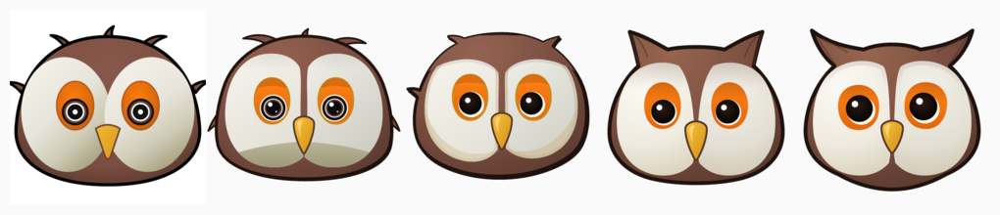
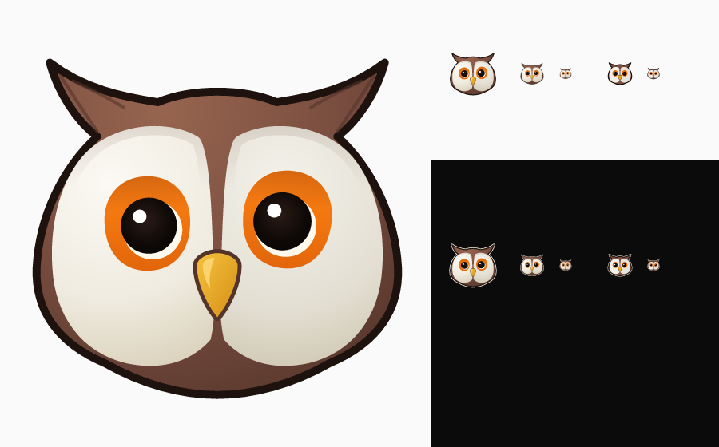

---
relationships:
  references: README
  uses: owl-demo-target
---

# Logo

The agent-svgtools logo is an owl's head. An agent drew it by hand in SVG,
using the [owl demo target](../targets/owl.png) as reference and agent-svgtools
to check each round. The logo is itself a demonstration of what the tool helps an
agent do, and each revision is kept here.



## Versions

| Version | Rounds | Independent grade |
| --- | ---: | --- |
| [v1](v1/) | 18 | Illustration B+, logo B, favicon B+ |

Each version folder holds the four forms of the mark:

| File | Use |
| --- | --- |
| `owl.svg` | The full mark, for light backgrounds. |
| `owl-dark.svg` | The full mark with a cream keyline, for dark backgrounds. |
| `owl-small.svg` | The flat mark for sizes below 48px. |
| `owl-small-dark.svg` | The flat mark with a cream keyline. The favicons use this form. |



## How v1 was made

1. **Reference.** `agent-svgtools colors` gave the palette of the target. Zoomed
   crops of the eyes, beak and crown gave the structure. The geometry is in the
   pixel space of the target, so any region can be scored against it with
   `agent-svgtools judge`.
2. **Rounds.** Each round changed the generator, rendered the mark at 512, 64, 32
   and 16px on light and dark backgrounds with `agent-svgtools render`, and
   scored the eye region with `judge`.
3. **Independent judge.** Every few rounds a different model, which had not seen
   the drawing work, graded the renders and named the top problems. The next
   rounds fixed them. Its grades went from B− to B+ for the illustration and
   from C+ to B for the logo.
4. **Redraw.** Polish stalled at B−. A redraw of the large shapes (ear tufts, a
   lighter chin, facial discs that taper into the beak) is what moved the grade.
5. **Audit.** `agent-svgtools inspect` reports 19 named components, 17 paths,
   122 path commands, 22 colours and vector-only content for `owl.svg`.

The judge's priorities for the next revision: a more distinct expression,
deliberate eye crescents, a shorter brown divider between the facial discs, and
slimmer cheeks.

## Rebuild

[`gen.mjs`](gen.mjs) draws the mark. [`assets.mjs`](assets.mjs) builds the
logos, favicons and social images in `docs/user/assets/` from it.
[`build.sh`](build.sh) runs both and renders the PNGs and `favicon.ico`:

```bash
demo/logo/build.sh v1
```

It needs node, agent-svgtools, ImageMagick, and the Geist and Geist Mono fonts.

## Revise

Edit `gen.mjs`, then run `build.sh` with the next version name, for example
`demo/logo/build.sh v2`. The new folder holds the new mark, and the earlier
folders stay as they are. Add a row to the versions table and update the
`progress.png` strip.
