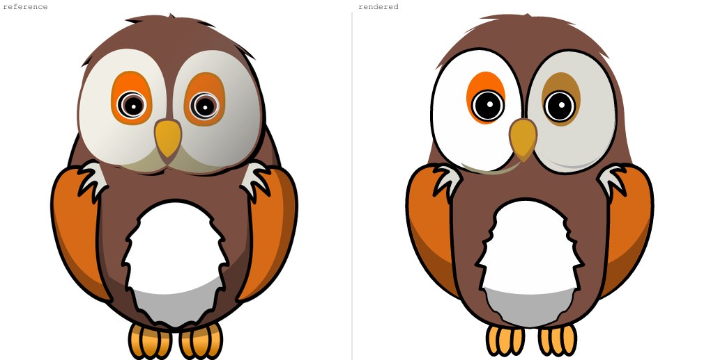

---
relationships:
  references: README
---

# Owl reconstruction demo

This demo replays the measured steps from a fresh, skill-guided agent run. The
agent first read `agent-svgtools skill`, decomposed the raster into semantic
components, and authored a complete SVG before making two focused revisions.
Automatic trace was not used.


The terminal recording uses the preserved SVG from each real state; the scores
are recomputed by `agent-svgtools` during playback. After each score, the GIF
cuts to that version's reference-versus-rendered comparison before returning to
the next focused revision. After the final audit, it closes on the completed SVG
and its handoff facts rather than ending on terminal output.

| State | Focus | Foreground score |
| --- | --- | ---: |
| First pass | Complete layered owl | 66.63 |
| Revision 1 | Replace the round dome with a feathered crown | 68.34 |
| Final | Widen and lower both wing silhouettes | 69.59 |

The final `inspect` result reports 30 authored graphics, 22 paths, 173 path
commands, 37 named components, 12 colors, and vector-only content. The result
is deliberately concise and editable rather than a traced collection of
micro-paths.



The final remains an approximation: its facial shading and eye rings are
simpler, the beak is slightly shorter, and the feet are less interlocked than
the raster reference.

## Reproduce the recording

Run the build script from anywhere inside the checkout. It records the terminal
session with VHS, renders each preserved SVG, creates three comparison cards,
creates a final artwork card, and uses `gifsicle` to splice and optimize the
final GIF:

```bash
./demo/owl-reconstruction/build-demo.sh
```
